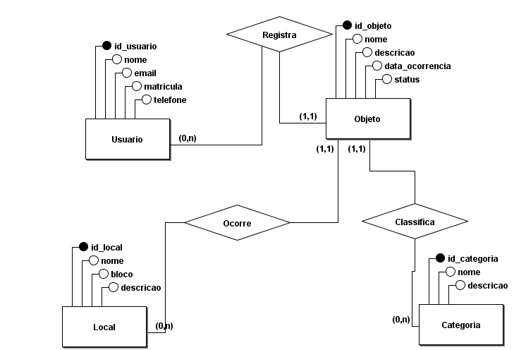

# Sistema Web de Achados e Perdidos

Projeto Integrador da disciplina de Banco de Dados I, do curso de Bacharelado em Engenharia da Computação.

## Objetivo

Desenvolver uma base de dados relacional para o gerenciamento de objetos perdidos e encontrados no ambiente acadêmico, com futura integração a uma aplicação web com funcionalidades CRUD.

## Integrantes

- Jorge Matheus
- Gustavo Amaral

## Etapas do projeto

- **APD1:** Modelagem conceitual (MER).
- **APD2:** Modelo lógico e normalização.
- **APD3:** Implementação física e consultas SQL.
- **APD4:** Aplicação web integrada ao banco de dados.

## Modelagem conceitual

O MER possui quatro entidades principais: Usuario, Objeto, Categoria e Local.

## Documentação

A documentação técnica incremental está disponível em [documentacao-tecnica.md](docs/documentacao-tecnica.md).

## Tecnologias previstas

- brModelo
- PostgreSQL
- Supabase
- HTML, CSS e JavaScript
- Git e GitHub