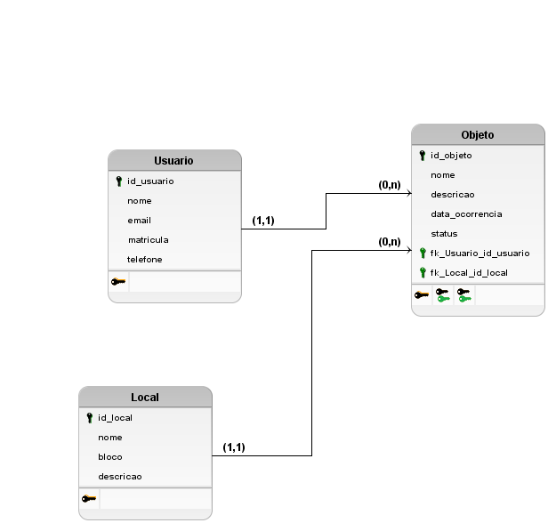

# Projeto Integrador de Banco de Dados I

## APD1 — Modelagem Conceitual

**Projeto:** Sistema Web de Achados e Perdidos para Ambiente Acadêmico  
**Curso:** Bacharelado em Engenharia da Computação  
**Disciplina:** Banco de Dados I

**Integrantes:**
- Jorge Matheus
- Gustavo Amaral

### 1. Contextualização

Em instituições de ensino, alunos, professores e funcionários podem perder ou encontrar objetos em salas de aula, laboratórios, bibliotecas e demais espaços. A divulgação informal dificulta localizar os responsáveis e acompanhar a devolução dos itens.

O Sistema Web de Achados e Perdidos propõe centralizar os registros de objetos, usuários responsáveis pelos registros e locais de ocorrência.

### 2. Objetivo

Estruturar uma base de dados relacional para organizar objetos perdidos e encontrados no ambiente acadêmico e, posteriormente, integrá-la a uma aplicação web com operações CRUD e consultas.

### 3. Requisitos funcionais

- **RF01:** Cadastrar usuários.
- **RF02:** Cadastrar locais da instituição.
- **RF03:** Cadastrar objetos perdidos ou encontrados, vinculando-os a um usuário e a um local.
- **RF04:** Consultar os objetos cadastrados.
- **RF05:** Editar os dados dos objetos.
- **RF06:** Excluir registros de objetos.
- **RF07:** Pesquisar objetos por nome, local ou status.
- **RF08:** Alterar o status dos objetos entre PERDIDO, ENCONTRADO e DEVOLVIDO.

### 4. Regras de negócio

- **RN01:** Cada usuário, local e objeto possui um identificador único.
- **RN02:** Cada objeto possui um usuário responsável pelo registro.
- **RN03:** Um usuário pode registrar vários objetos.
- **RN04:** Cada objeto está associado a um local da instituição.
- **RN05:** Um local pode estar associado a vários objetos.
- **RN06:** Cada objeto possui um status: PERDIDO, ENCONTRADO ou DEVOLVIDO.
- **RN07:** O e-mail do usuário deve ser único; a matrícula, quando informada, também deve ser única.

### 5. Modelo Entidade-Relacionamento (MER)

O modelo conceitual foi desenvolvido no brModelo e, após a revisão orientada pelo professor, contém três entidades:

- **USUARIO:** `id_usuario` (identificador), `nome`, `email`, `matricula`, `telefone`.
- **LOCAL:** `id_local` (identificador), `nome`, `bloco`, `descricao`.
- **OBJETO:** `id_objeto` (identificador), `nome`, `descricao`, `data_ocorrencia`, `status`.

### 6. Relacionamentos e cardinalidades

- **USUARIO — REGISTRA — OBJETO:** o sistema associa o registro de cada objeto a um usuário.
- **LOCAL — ACHADO — OBJETO:** o sistema associa cada objeto ao local da ocorrência.

As cardinalidades e sua representação gráfica devem ser conferidas no arquivo editável do MER aprovado em sala. Na implementação relacional adotada, cada objeto referencia um usuário e um local, e um usuário ou local pode estar associado a vários objetos.

### 7. Justificativa da modelagem

A entidade OBJETO representa os registros centrais da solução. USUARIO e LOCAL foram modeladas separadamente para evitar a repetição de informações de responsáveis e espaços físicos em cada objeto. A entidade CATEGORIA e seu relacionamento foram retirados conforme a revisão do modelo solicitada pelo professor.

### 8. Tecnologias

- **brModelo:** modelagem conceitual e lógica.
- **PostgreSQL / Supabase:** implementação e consultas ao banco de dados.
- **Visual Studio Code:** edição dos arquivos do projeto.
- **Git e GitHub:** versionamento dos artefatos.
- **HTML, CSS e JavaScript:** tecnologias previstas para o MVP web.

---

## APD2 — Modelo Lógico e Normalização

### 1. Modelo lógico relacional

O modelo lógico foi elaborado a partir do MER corrigido. Ele contém três tabelas relacionadas:

- **USUARIO**(`id_usuario` PK, `nome`, `email`, `matricula`, `telefone`)
- **LOCAL**(`id_local` PK, `nome`, `bloco`, `descricao`)
- **OBJETO**(`id_objeto` PK, `nome`, `descricao`, `data_ocorrencia`, `status`, `id_usuario` FK, `id_local` FK)

As chaves estrangeiras de OBJETO referenciam `USUARIO(id_usuario)` e `LOCAL(id_local)`. Os nomes de campos no SQL do brModelo podem diferir dos nomes simplificados adotados nos scripts PostgreSQL.

### 2. Primeira Forma Normal (1FN)

Cada atributo foi definido para armazenar um valor individual, sem listas ou grupos repetidos. Considerando o preenchimento atômico dos campos, o modelo atende à 1FN.

### 3. Segunda Forma Normal (2FN)

As tabelas possuem chaves primárias simples. Considerando as dependências funcionais definidas para o projeto, não há dependências parciais de chaves compostas; portanto, o modelo atende à 2FN.

### 4. Terceira Forma Normal (3FN)

As informações dos usuários e locais são mantidas em tabelas próprias. A tabela OBJETO guarda apenas suas informações específicas e as referências aos respectivos registros, evitando repetir nome, e-mail, bloco e descrição do local em cada ocorrência. Sob as regras de negócio estabelecidas, não foram identificadas dependências transitivas que violem a 3FN.

### 5. Justificativa da normalização

A separação entre USUARIO, LOCAL e OBJETO reduz redundâncias e anomalias de atualização, inserção e exclusão, além de facilitar consultas relacionais e a manutenção dos dados.

### 6. Conclusão da APD2

O modelo lógico traduz as entidades e os relacionamentos em tabelas, chaves primárias e estrangeiras. A análise das dependências funcionais previstas indica atendimento à 1FN, 2FN e 3FN.

---

## APD3 — Implementação Física do Banco de Dados

### 1. Objetivo

Implementar no PostgreSQL a estrutura relacional definida nas etapas anteriores, inserir registros fictícios e demonstrar a recuperação de informações com consultas SQL.

### 2. Tecnologias utilizadas

O banco foi implementado em **PostgreSQL**, disponibilizado pelo **Supabase**. O Visual Studio Code foi utilizado na organização dos scripts e o GitHub no versionamento dos artefatos.

### 3. Implementação das tabelas

Foram implementadas as tabelas **usuario**, **local** e **objeto**. Cada tabela possui chave primária; `objeto` contém chaves estrangeiras para `usuario` e `local`. Foram previstas restrições como `NOT NULL`, `UNIQUE` e `CHECK` para preservar a integridade dos registros.

Script: [`database/01_create_tables.sql`](../database/01_create_tables.sql).

### 4. Inserção de dados

Foram utilizados dados fictícios para testar os relacionamentos, incluindo usuários, locais e objetos nos estados PERDIDO, ENCONTRADO e DEVOLVIDO.

Script: [`database/02_insert_data.sql`](../database/02_insert_data.sql). O script de inserção deve ser utilizado na configuração de uma base nova, não repetido indiscriminadamente na base já populada.

### 5. Consultas SQL

As consultas demonstram:

- `SELECT`, `WHERE` e `ORDER BY` para listagem, filtros e ordenação;
- `INNER JOIN` e `LEFT JOIN` para relacionar objetos, usuários e locais;
- `GROUP BY` e `COUNT` para contagem de objetos por local ou status;
- subconsultas com `IN` e `EXISTS` para recuperação condicionada de registros.

Script: [`database/03_queries.sql`](../database/03_queries.sql).

### 6. Evidências de execução

As capturas abaixo devem corresponder à execução das consultas **atualizadas**, sem referências à tabela CATEGORIA.

**Consulta 5 — Objetos, usuários e locais**

**Consulta 6 — Quantidade de objetos por local**

**Consulta 8 — Subconsulta de objetos da Biblioteca**

### 7. Resultados

As consultas realizadas demonstraram a recuperação de objetos vinculados a usuários e locais. Após a revisão do modelo, a estrutura do banco foi adaptada para retirar a entidade CATEGORIA e sua referência na tabela OBJETO, preservando os registros de teste das demais tabelas.

### 8. Conclusão

A implementação física disponibiliza uma base relacional para consultas e operações CRUD. A próxima etapa será desenvolver o MVP web integrado ao PostgreSQL/Supabase, com atenção às políticas de acesso do banco.

---

## APD4 — Próxima etapa

Implementar a aplicação web com funcionalidades de cadastro, consulta, atualização e exclusão, integrada às tabelas do projeto. Esta etapa ainda não está documentada como concluída.
