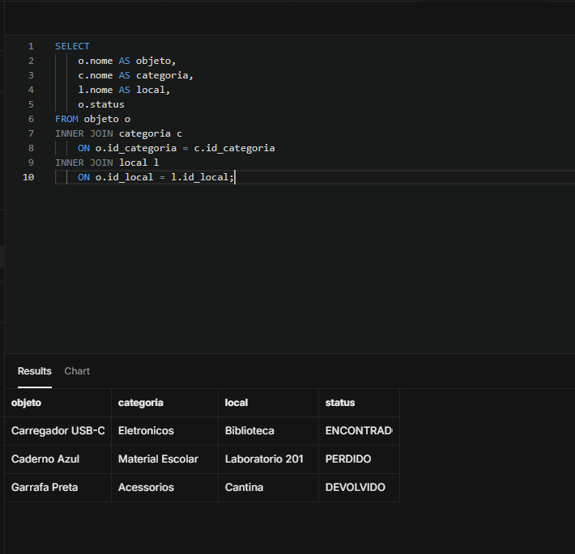
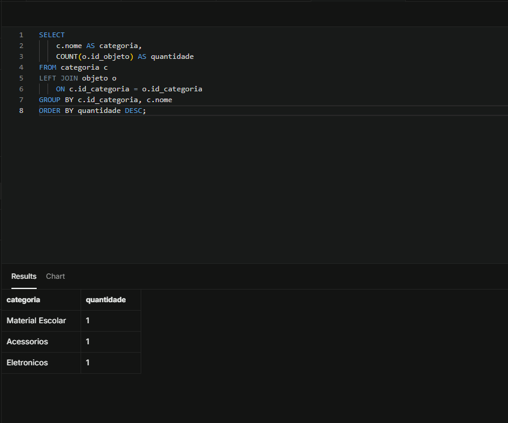
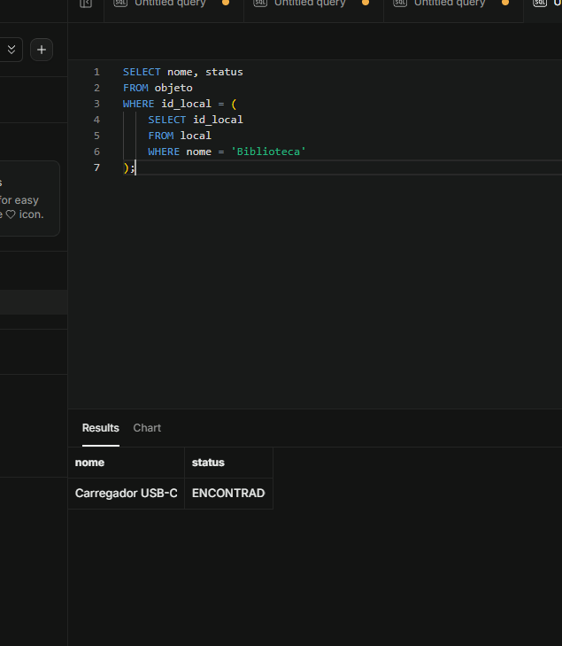

# Projeto Integrador de Banco de Dados I
## APD1 — Modelagem Conceitual

**Projeto:** Sistema Web de Achados e Perdidos para Ambiente Acadêmico

**Curso:** Bacharelado em Engenharia da Computação

**Disciplina:** Banco de Dados I

**Integrantes:**
- Jorge Matheus
- Gustavo Amaral

### 1. Contextualização

Em instituições de ensino, é comum que alunos, professores e funcionários percam ou encontrem objetos pessoais em salas de aula, laboratórios, bibliotecas e demais espaços.

A divulgação desses objetos geralmente ocorre de maneira informal, dificultando sua identificação e devolução.

O Sistema Web de Achados e Perdidos tem como proposta centralizar essas informações, proporcionando maior organização e facilidade na consulta dos registros.

### 2. Objetivo

Desenvolver uma base de dados relacional para gerenciar objetos perdidos e encontrados no ambiente acadêmico.

O sistema permitirá registrar informações sobre os objetos, seus responsáveis, categorias e locais de ocorrência.

Posteriormente, a base de dados será integrada a uma aplicação web com funcionalidades CRUD e consultas.

### 3. Requisitos funcionais

- RF01 — Cadastrar usuários.
- RF02 — Cadastrar categorias de objetos.
- RF03 — Cadastrar locais da instituição.
- RF04 — Cadastrar objetos perdidos ou encontrados.
- RF05 — Consultar objetos cadastrados.
- RF06 — Editar informações dos objetos.
- RF07 — Excluir registros de objetos.
- RF08 — Pesquisar objetos por nome, categoria, local e status.
- RF09 — Atualizar o status dos objetos para perdido, encontrado ou devolvido.

### 4. Regras de negócio

- RN01 — Cada usuário possui um identificador único.
- RN02 — Um usuário pode registrar vários objetos.
- RN03 — Cada objeto deve estar associado a exatamente um usuário.
- RN04 — Cada objeto pertence a uma única categoria.
- RN05 — Uma categoria pode classificar vários objetos.
- RN06 — Cada objeto deve estar associado a um local.
- RN07 — Um local pode estar associado a vários objetos.
- RN08 — Cada objeto possui um status que indica sua situação atual.
- RN09 — O e-mail e a matrícula dos usuários, quando informada, devem ser únicos.

### 5. Modelo Entidade-Relacionamento (MER)

O modelo conceitual foi desenvolvido utilizando o software brModelo.

Foram definidas quatro entidades principais:

**USUARIO:** armazena informações dos responsáveis pelos registros.

Atributos: id_usuario (identificador), nome, email, matricula e telefone.

**OBJETO:** armazena as informações dos objetos perdidos ou encontrados.

Atributos: id_objeto (identificador), nome, descricao, data_ocorrencia e status.

**CATEGORIA:** representa a classificação dos objetos.

Atributos: id_categoria (identificador), nome e descricao.

**LOCAL:** representa os espaços físicos da instituição.

Atributos: id_local (identificador), nome, bloco e descricao.

### 6. Relacionamentos e cardinalidades

**USUARIO — REGISTRA — OBJETO**

Um usuário pode registrar zero ou vários objetos. Cada objeto deve possuir exatamente um usuário responsável.

Cardinalidade: 1:N.

**CATEGORIA — CLASSIFICA — OBJETO**

Uma categoria pode classificar zero ou vários objetos. Cada objeto deve pertencer a exatamente uma categoria.

Cardinalidade: 1:N.

**LOCAL — OCORRE — OBJETO**

Um local pode estar associado a zero ou vários registros de objetos. Cada objeto deve estar associado a exatamente um local.

Cardinalidade: 1:N.

### 7. Justificativa da modelagem

A entidade OBJETO foi definida como elemento central do sistema, pois representa as ocorrências que serão registradas.

As entidades USUARIO, CATEGORIA e LOCAL foram separadas para organizar as informações e evitar a repetição desnecessária de dados.

Essa estrutura permite que um mesmo usuário registre diferentes objetos, que vários objetos compartilhem uma categoria e que um mesmo local esteja associado a diversas ocorrências.

A utilização de identificadores únicos facilita a identificação dos registros e prepara a base para o desenvolvimento do modelo lógico e a aplicação das regras de normalização nas próximas etapas.

### 8. Tecnologias previstas

- brModelo: elaboração dos modelos conceitual e lógico.
- PostgreSQL/Supabase: implementação futura do banco de dados relacional.
- HTML, CSS e JavaScript: desenvolvimento previsto da interface web.
- Git e GitHub: versionamento dos arquivos e documentação.

## APD2 — Modelo Lógico e Normalização

### 1. Modelo lógico relacional

O modelo lógico foi elaborado utilizando o software brModelo, a partir do Modelo Entidade-Relacionamento desenvolvido na APD1.

O banco de dados é composto por quatro tabelas: USUARIO, CATEGORIA, LOCAL e OBJETO.

A tabela OBJETO representa a entidade central do sistema e contém três chaves estrangeiras responsáveis por estabelecer os relacionamentos com as demais tabelas.

**Esquema relacional:**

- USUARIO(id_usuario PK, nome, email, matricula, telefone)
- CATEGORIA(id_categoria PK, nome, descricao)
- LOCAL(id_local PK, nome, bloco, descricao)
- OBJETO(id_objeto PK, nome, descricao, data_ocorrencia, status, id_usuario FK, id_categoria FK, id_local FK)

### 2. Primeira Forma Normal (1FN)

A Primeira Forma Normal determina que cada atributo deve armazenar valores atômicos, evitando grupos repetitivos ou múltiplos valores em um mesmo campo.

No modelo proposto, os atributos foram definidos para armazenar valores individuais. Por exemplo, cada objeto possui um único nome, uma data de ocorrência e um status.

Dessa forma, considerando o preenchimento atômico dos campos, o modelo atende à 1FN.

### 3. Segunda Forma Normal (2FN)

A Segunda Forma Normal exige que o modelo esteja na 1FN e que os atributos não-chave não dependam apenas de parte de uma chave candidata composta.

As quatro tabelas possuem chaves primárias simples, formadas por um único identificador.

Considerando também que não foram definidas outras chaves candidatas compostas com dependências parciais, o modelo atende à 2FN.

### 4. Terceira Forma Normal (3FN)

A Terceira Forma Normal busca eliminar dependências transitivas indevidas entre atributos.

No modelo desenvolvido, os dados dos usuários, categorias e locais foram organizados em tabelas específicas, evitando sua repetição na tabela OBJETO.

Assim, as informações descritivas dessas entidades permanecem relacionadas aos seus respectivos identificadores.

Considerando as dependências funcionais previstas nas regras de negócio, não foram identificadas dependências transitivas que violem a 3FN.

### 5. Justificativa da normalização

A organização da base de dados busca reduzir a redundância, melhorar a consistência das informações e evitar anomalias de inserção, atualização e exclusão.

A separação das entidades também facilita a manutenção do banco e a implementação de consultas SQL utilizando relacionamentos entre tabelas.

### 6. Conclusão da APD2

A transformação do MER para o modelo lógico permitiu definir as tabelas, chaves primárias, chaves estrangeiras e relacionamentos necessários ao sistema.

A análise de normalização indica que a estrutura proposta atende à 1FN, 2FN e 3FN, considerando as regras de negócio estabelecidas.

O modelo servirá como base para a implementação física em um SGBD relacional durante a APD3.

## APD3 — Implementação Física do Banco de Dados

### 1. Objetivo

A terceira etapa do Projeto Integrador teve como objetivo implementar fisicamente a base de dados relacional desenvolvida nas etapas anteriores, utilizando um Sistema Gerenciador de Banco de Dados (SGBD).

### 2. Tecnologias utilizadas

Foi utilizado o PostgreSQL, disponibilizado pela plataforma Supabase, para criação e gerenciamento das tabelas e execução dos comandos SQL.

O Visual Studio Code foi utilizado para organizar os scripts e a documentação, enquanto o GitHub foi utilizado para versionamento dos arquivos do projeto.

### 3. Implementação das tabelas

Foram criadas quatro tabelas relacionadas:

- USUARIO: armazena os dados dos usuários responsáveis pelos registros.
- CATEGORIA: armazena as classificações dos objetos.
- LOCAL: armazena os locais de ocorrência.
- OBJETO: armazena os objetos perdidos ou encontrados.

As tabelas possuem chaves primárias e relacionamentos definidos por chaves estrangeiras, garantindo a integridade referencial.

Também foram utilizadas restrições como NOT NULL, UNIQUE e CHECK para melhorar a consistência dos dados.

O script de criação está disponível em `database/01_create_tables.sql`.

### 4. Inserção de dados

Foram inseridos registros fictícios nas quatro tabelas para permitir a execução de testes e consultas.

Os dados incluem usuários, categorias, locais e objetos com diferentes situações, como PERDIDO, ENCONTRADO e DEVOLVIDO.

O script está disponível em `database/02_insert_data.sql`.

### 5. Consultas SQL

Foram elaboradas consultas para demonstrar a manipulação e recuperação de informações armazenadas no banco.

Entre os recursos utilizados estão:

- SELECT e WHERE para consultas e filtros;
- ORDER BY para ordenação;
- INNER JOIN para relacionar registros;
- LEFT JOIN para incluir registros sem correspondência;
- GROUP BY e COUNT para agrupamento e contagem;
- Subconsultas com IN, EXISTS e comparação de valores.

As consultas estão organizadas em `database/03_queries.sql`.

### 6. Evidências de execução

Foram registradas capturas de tela dos resultados das consultas no SQL Editor do Supabase.

**Consulta 5 — Relacionamento entre objetos, categorias e locais**

**Consulta 6 — Quantidade de objetos por categoria**

**Consulta 8 — Subconsulta para objetos da Biblioteca**

### 7. Resultados

A execução das consultas permitiu verificar a recuperação de informações de diferentes tabelas, demonstrando o funcionamento dos relacionamentos estabelecidos no modelo lógico.

Os resultados também demonstraram a possibilidade de realizar filtros, agrupamentos e subconsultas utilizando SQL.

### 8. Conclusão

A implementação física do banco de dados permitiu transformar o modelo lógico em uma estrutura funcional no PostgreSQL.

As tabelas, os relacionamentos e as consultas desenvolvidas constituem a base para a próxima etapa do projeto, que será a integração com uma aplicação web contendo funcionalidades CRUD.

**APD4:** desenvolvimento de um MVP web integrado ao banco de dados, com funcionalidades CRUD e consultas.